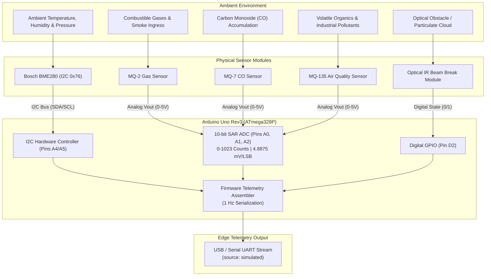
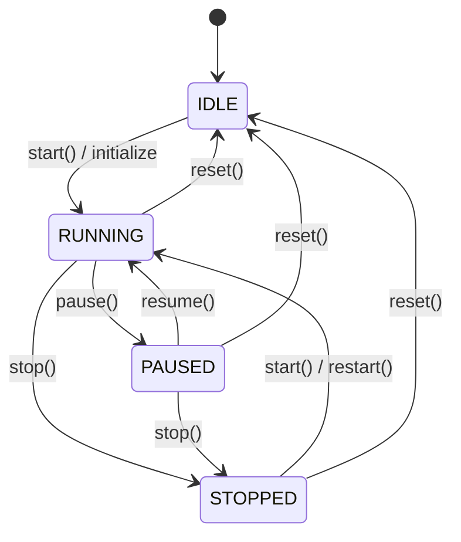
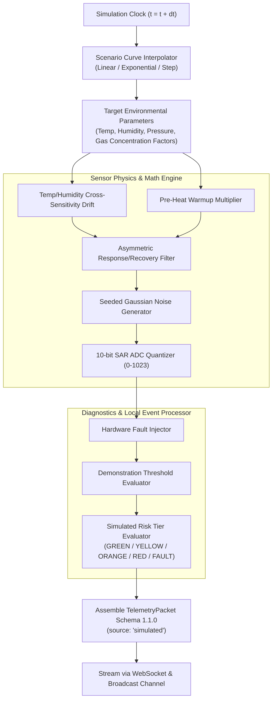
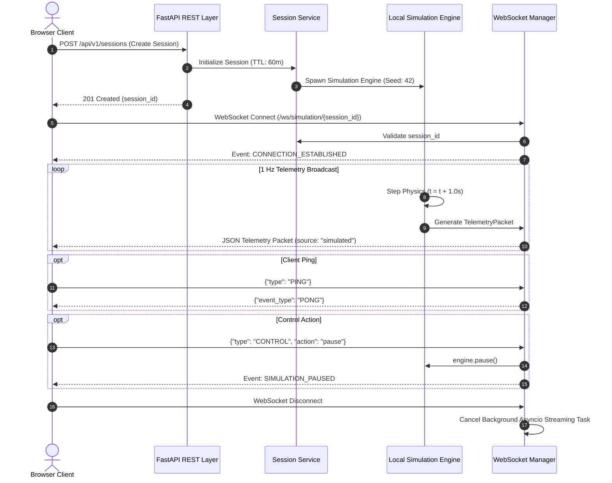
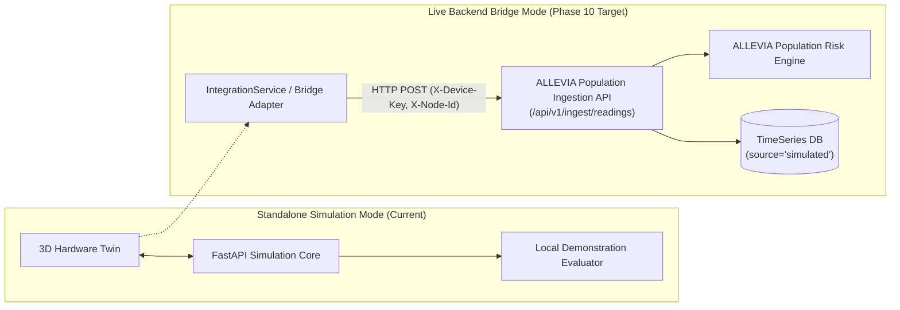

# ALLEVIA Environment Simulator
### Interactive 3D Digital Twin & Environmental Sensor Telemetry Simulation Platform

[](#technology-stack)
[](https://nodejs.org/)
[](https://python.org/)
[](https://www.typescriptlang.org/)
[](https://fastapi.tiangolo.com/)
[](https://react.dev/)
[](https://threejs.org/)
[](https://tailwindcss.com/)
[](#22-license-and-project-status)
[](#8-simulation-engine-architecture)

> **Simulation Classification:** Standalone Software-in-the-Loop (SIL) Digital Twin and Deterministic Numerical Telemetry Generator. Every emitted packet and telemetry log is explicitly tagged with `"source": "simulated"`.

---

## Table of Contents

- [1. Executive Overview](#1-executive-overview)
- [2. Problem Statement](#2-problem-statement)
- [3. Proposed Solution](#3-proposed-solution)
- [4. Key Capabilities & Features](#4-key-capabilities--features)
- [5. Physical Hardware Architecture](#5-physical-hardware-architecture)
  - [5.1 Verified Component Specifications](#51-verified-component-specifications)
  - [5.2 Pin Mapping Matrix](#52-pin-mapping-matrix)
  - [5.3 Hardware Data-Flow Architecture](#53-hardware-data-flow-architecture)
  - [5.4 Negative Scope Constraints](#54-negative-scope-constraints)
- [6. The Six Environmental Scenarios](#6-the-six-environmental-scenarios)
  - [6.1 Scenario 1: Normal Day (`scenario-01`)](#61-scenario-1-normal-day-scenario-01)
  - [6.2 Scenario 2: Midday Heatwave (`scenario-02`)](#62-scenario-2-midday-heatwave-scenario-02)
  - [6.3 Scenario 3: Humid Heat (`scenario-03`)](#63-scenario-3-humid-heat-scenario-03)
  - [6.4 Scenario 4: Smoke or Dust Episode (`scenario-04`)](#64-scenario-4-smoke-or-dust-episode-scenario-04)
  - [6.5 Scenario 5: Gas Leak Demo (`scenario-05`)](#65-scenario-5-gas-leak-demo-scenario-05)
  - [6.6 Scenario 6: Sensor Fault & Diagnostics (`scenario-06`)](#66-scenario-6-sensor-fault--diagnostics-scenario-06)
  - [6.7 Comparative Scenario Profile Matrix](#67-comparative-scenario-profile-matrix)
- [7. Simulation Engine Architecture](#7-simulation-engine-architecture)
  - [7.1 Simulation Clock & Deterministic State Machine](#71-simulation-clock--deterministic-state-machine)
  - [7.2 Mathematical & Physical Models](#72-mathematical--physical-models)
  - [7.3 Simulation Processing Pipeline](#73-simulation-processing-pipeline)
- [8. Real-Time Telemetry & Network Architecture](#8-real-time-telemetry--network-architecture)
  - [8.1 WebSocket Streaming & Message Flow](#81-websocket-streaming--message-flow)
  - [8.2 Multi-Node Sensor Network Simulation (N01–N05)](#82-multi-node-sensor-network-simulation-n01n05)
  - [8.3 Autonomous Background Worker (`simulator_worker.py`)](#83-autonomous-background-worker-simulator_workerpy)
- [9. Technology Stack](#9-technology-stack)
- [10. Project Directory Architecture](#10-project-directory-architecture)
- [11. Installation & Local Setup](#11-installation--local-setup)
  - [11.1 Prerequisites](#111-prerequisites)
  - [11.2 Frontend Setup](#112-frontend-setup)
  - [11.3 Backend Setup](#113-backend-setup)
  - [11.4 Docker Compose Orchestration](#114-docker-compose-orchestration)
- [12. Environment Variables & Configuration](#12-environment-variables--configuration)
  - [12.1 Backend Environment Configuration](#121-backend-environment-configuration)
  - [12.2 Frontend Environment Configuration](#122-frontend-environment-configuration)
- [13. RESTful API & WebSocket Endpoints](#13-restful-api--websocket-endpoints)
- [14. Telemetry Packet Schema](#14-telemetry-packet-schema)
  - [14.1 Canonical Schema v1.1.0 JSON Example](#141-canonical-schema-v110-json-example)
  - [14.2 Detailed Field Specifications](#142-detailed-field-specifications)
- [15. Verification, Testing & Quality Assurance](#15-verification-testing--quality-assurance)
  - [15.1 Automated Test Execution](#151-automated-test-execution)
  - [15.2 Quality Gate Summary](#152-quality-gate-summary)
- [16. Performance & Accessibility](#16-performance--accessibility)
- [17. Limitations & Scientific Data Integrity](#17-limitations--scientific-data-integrity)
- [18. Main ALLEVIA Platform Integration](#18-main-allevia-platform-integration)
- [19. User Interface Layout & Visual Demonstrations](#19-user-interface-layout--visual-demonstrations)
- [20. Future Enhancements](#20-future-enhancements)
- [21. License & Project Status](#21-license--project-status)

---

## 1. Executive Overview

The **ALLEVIA Environment Simulator** is an interactive, web-based 3D digital twin and environmental sensor simulation platform. It was engineered as a high-fidelity virtual representation of the physical **ALLEVIA Detector Box**—an Internet of Things (IoT) edge device developed for the **ALLEVIA Population and Workforce Health Early Warning System**.

The platform serves as an evaluation and demonstration cockpit for hackathon judges, technical reviewers, industrial safety officers, and clinical stakeholders. By providing a virtual digital twin combined with a numerical sensor physics engine, the simulator reproduces the electrical, atmospheric, and chemical dynamics of real-world environmental hazards without requiring access to physical hardware, toxic gas canisters, or environmental testing chambers.

Users can inspect the internal component architecture of the Detector Box through a transparent acrylic chassis, interactively adjust environmental parameters (ambient temperature, relative humidity, AQI, and gas concentrations), observe real-time 10-bit Successive Approximation Register (SAR) ADC quantization, and monitor live telemetry streams across simulated sensor nodes representing major industrial zones in Abu Dhabi (Mussafah, ICAD, KEZAD, Zayed Port, and Al Mafraq).

---

## 2. Problem Statement

Evaluating, demonstrating, and stress-testing industrial environmental monitoring hardware involves steep logistical challenges:

1. **Hardware Accessibility Constraints:** Physical detector enclosures, custom microcontroller carrier boards, and breakout sensors cannot be distributed instantaneously to distributed hackathon judges or remote technical evaluators.
2. **Hazardous Scenario Reproduction:** Safe demonstration of critical workplace hazards—such as acute Carbon Monoxide ($CO$) leaks, combustible gas accumulation, and severe thermal heatwaves—is practically impossible in an indoor conference or evaluation room.
3. **Sensor Kinetics Complexity:** Metal-oxide semiconductor ($SnO_2$) gas sensors exhibit complex physical behaviors including heater warm-up latencies, non-linear logarithmic voltage divider responses, thermal cross-sensitivities, and asymmetric clearing recoveries that standard static mockups fail to depict.
4. **Telemetry Inspection & Protocol Validation:** Downstream ingestion pipelines, early warning algorithms, and clinical triage dashboards require structured, watermarked telemetry streams that conform strictly to hardware serialization boundaries.
5. **Testing & Diagnostic Verification:** Validating firmware fault handling (e.g., $I^2C$ bus dropouts, open-circuit ground pull-ups, or optical beam occlusions) requires repeatable, non-destructive fault injection mechanisms.

---

## 3. Proposed Solution

The **ALLEVIA Environment Simulator** provides a unified Software-in-the-Loop (SIL) simulation ecosystem that solves these challenges through five cohesive subsystems:

```
┌─────────────────────────────────────────────────────────────────────────────┐
│                       ALLEVIA SIMULATION ECOSYSTEM                          │
├─────────────────────┬─────────────────────┬─────────────────────────────────┤
│   3D DIGITAL TWIN   │  NUMERICAL PHYSICS  │     TELEMETRY & INGESTION       │
│  Interactive Three  │ Deterministic 10-bit│  Real-Time Schema 1 Broadcast   │
│  WebGL Hardware Box │ SAR ADC & MOS Curve │  & 60s Abu Dhabi Network Cycle  │
├─────────────────────┴─────────────────────┴─────────────────────────────────┤
│                     REAL-TIME OPERATOR COCKPIT                              │
│    Left: Editable Parameters  │  Center: 3D Twin  │  Right: Telemetry Log   │
└─────────────────────────────────────────────────────────────────────────────┘
```

1. **Procedural 3D Digital Twin:** Built with Three.js, rendering a physical chassis with a transparent acrylic top, an authentic blue Arduino Uno board with an ATmega328P DIP-28 MCU, color-coded jumper wiring, brass standoffs, and verified sensor breakouts with tap-to-inspect component metadata and dynamic atmospheric particle fields.
2. **Deterministic Numerical Physics Engine:** A Python 3.11+ simulation core modeling 10-bit ADC conversion, metal-oxide surface conductivity, exponential thermal lag, warm-up transients, and reproducible pseudo-random Gaussian noise.
3. **Six Environmental Scenarios:** Data-driven scenario definitions spanning nominal baselines, extreme thermal heatwaves, suffocating humid heat, airborne smoke ingress, toxic $CO$ gas emergencies, and hardware diagnostics.
4. **Real-Time Telemetry Streaming:** Sub-second WebSocket streaming (`/ws/simulation/{session_id}`) and a 60-second multi-node network ingest cycle with clear `"source": "simulated"` watermarks.
5. **Apple-Minimalist Single-Screen UI:** A streamlined, non-scrollable three-column judging layout fitting exactly within `100dvh × 100vw` with zero outer scrollbars, instant theme switching (Light/Dark), live slider parameter movement, and detailed unit conversion specs.

---

## 4. Key Capabilities & Features

- **Interactive 3D Hardware Twin (WebGL / Three.js):**
  - High-precision procedural geometry representing the enclosure chassis ($160 \times 110 \times 32\text{ mm}$), transparent acrylic top lid (`MeshPhysicalMaterial`, transmission: $0.95$, opacity: $0.16$), and brass standoffs.
  - Realistic internal electronic components: Arduino Uno Rev3 PCB with gold-plated pin headers, ATmega328P DIP-28 microcontroller, BME280 purple breakout, MQ-2, MQ-7 orange module, MQ-135 grey module, and optical IR sensor breakout with dual lenses.
  - Color-coded jumper wire harness modeling $5\text{V}$ power (red), ground (charcoal grey), and analog/digital signal paths.
  - Smooth OrbitControls with restricted polar angles, rotation damping, tap-to-inspect part identification cards, and a dedicated **Reset View** camera control.
  - Atmospheric particle system rendering soft circular radial-gradient gas orbs that change color dynamically (Green for $CO$, Charcoal Black for Smoke, Amber for LPG, Light Grey for Clean Air) and scale in density based on AQI (40 to 450 particles), alongside thermal convection (red) and moisture vapor (blue) particles.
- **Single-Screen Judging Simulator Layout:**
  - Standardized three-column architecture:
    - **Left Column:** Environmental Parameters Panel (Node selector N01–N05, site information, air speed wind toggle, battery status toggle, Temperature slider, Humidity slider, AQI slider, and harmful gas toggles).
    - **Center Column:** Large interactive 3D Detector Box with floating telemetry pill, tap-to-inspect overlays, and reset camera button.
    - **Right Column:** Live Sensor Network panel with active pulsing status, 60s countdown progress bar, segmented tabs (`All Nodes (Current vs Base)`, `Last Sent Payload (Schema 1)`, and `Transmission Logs`), and EPA breakpoint specifications.
- **Deterministic Numerical Simulation Core:**
  - 10-bit SAR ADC converter with $V_{\text{ref}} = 5.0\text{ V}$ ($0\text{--}1023$ integer counts, $\approx 4.8875\text{ mV/LSB}$).
  - Non-linear $SnO_2$ surface reaction kinetics with load resistor divider calculations ($R_L = 10\text{ k}\Omega$).
  - Pre-heating heater coil warm-up dynamics ($30\text{ s}$ stabilization curve).
  - Ambient temperature and humidity cross-sensitivity drift compensation.
  - Asymmetric dynamic response ($\tau_{\text{response}} \approx 6\text{ s}$) and recovery clearing ($\tau_{\text{recovery}} \approx 14\text{ s}$).
  - Seeded Gaussian pseudo-random noise generator ($\mathcal{N}(0, \sigma^2)$) for reproducible benchmarking.
- **Multi-Node Autonomous Sensor Network:**
  - Continuous background simulation of 5 regional monitoring nodes deployed across Abu Dhabi:
    - **N01:** Zone A — Mussafah Industrial Area (Site S13)
    - **N02:** Zone B — Industrial City of Abu Dhabi / ICAD (Site S03)
    - **N03:** Zone C — KEZAD Al Taweelah (Site S17)
    - **N04:** Zone D — Zayed Port / Mina Zayed (Site S20)
    - **N05:** Zone E — Al Mafraq Workers Residential City (Site S22)
  - Autonomous 60-second network cadence with EPA piecewise linear AQI-to-PM2.5 conversions, psychrometric Stull (2011) wet-bulb temperature, and Wet Bulb Globe Temperature (WBGT) calculations.
  - Exponential decay of manual parameter overrides back to UAE November environmental baselines.
- **Hardware Diagnostic Fault Injection:**
  - Simulated $I^2C$ bus disconnection on BME280 returning `-999.0` error codes.
  - Open-circuit analog ground pull-up on gas sensors railing to $1023$ counts.
  - Short-circuit faults dropping to $0$ counts.
  - Optical beam obstruction and signal flutter.

---

## 5. Physical Hardware Architecture

### 5.1 Verified Component Specifications

The virtual Detector Box strictly mirrors the verified physical hardware suite:

| Component | Hardware Role | Interface / Bus | Measurement Domain | Physical Characteristics | 3D Twin Representation |
| :--- | :--- | :--- | :--- | :--- | :--- |
| **Arduino Uno Rev3** | Main Microcontroller Board | USB / UART Serial | System processing, 10-bit SAR ADC sampling | ATmega328P MCU @ 16 MHz, 5V logic, 32 KB Flash, 2 KB SRAM | Royal blue PCB, 28-pin DIP socket, crystal oscillator, USB Type-B port, barrel jack, female headers |
| **Bosch BME280** | Digital Environmental Sensor | $I^2C$ (`0x76` / `0x77`) | Ambient Temp ($-40\text{--}+85^\circ\text{C}$), RH ($0\text{--}100\%$), Pressure ($300\text{--}1100\text{ hPa}$) | Pre-calibrated factory trim parameters, low noise ($0.2\text{ Pa}$), digital compensation | Purple rectangular breakout PCB with metallic sensor cap and 4 gold pin headers |
| **MQ-2** | Analog Gas & Smoke Sensor | Analog Voltage (`A0`) | Combustible gases (LPG, Propane, Methane: $200\text{--}5000\text{ ppm}$) and Smoke | Heated $SnO_2$ semiconductor surface, internal $5\text{V}$ coil, $10\text{ k}\Omega$ load resistor | Blue rectangular breakout board, circular stainless steel mesh chimney, brass ring |
| **MQ-7** | Analog Carbon Monoxide Sensor | Analog Voltage (`A1`) | Carbon Monoxide ($CO: 20\text{--}2000\text{ ppm}$) | Micro-ceramic tube with $Al_2O_3$, heated sensing layer, high/low voltage heating cycle | Blue rectangular breakout board, distinctive orange/gold housing collar, wire mesh |
| **MQ-135** | Analog Air Quality Sensor | Analog Voltage (`A2`) | Toxic gases ($NH_3, NO_x$, Alcohol, Benzene, Smoke, $CO_2$) | Sensitive to reducing and oxidizing gases, wide-spectrum ambient air monitoring | Blue rectangular breakout board, metallic grey cylinder housing with top mesh grille |
| **Optical IR Module** | Digital Obstacle / Event Sensor | Digital I/O (`D2`) | Optical beam interruption ($0 = \text{Clear}, 1 = \text{Obstructed}$) | Infrared LED transmitter and phototransistor receiver pair with comparator potentiometer | Blue breakout PCB with dual black optical LED barrels, indicator LED, 3-pin header |
| **Status LED Bar** | Visual Enclosure Indicator | Digital GPIO | Device operational status and battery warning indication | Multi-state LED illumination (Green pulse = running, Amber blink = low battery, White = idle) | Horizontal front-panel LED light diffuser integrated into enclosure faceplate |
| **Wiring & Chassis** | Enclosure & Interconnects | Point-to-point jumpers | Power delivery ($5\text{V}$, GND) and signal routing | Polycarbonate base ($160 \times 110 \times 32\text{ mm}$), transparent acrylic lid, M3 brass standoffs | Matte black lower housing, ventilated side slots, transparent acrylic top, multi-color jumper wires |

### 5.2 Pin Mapping Matrix

The internal electrical routing from the sensor suite to the Arduino Uno Rev3 is verified as follows:

| Sensor Module | Arduino Pin | Pin Type | Signal Description | Electrical Range | Operating Logic |
| :--- | :--- | :--- | :--- | :--- | :--- |
| **MQ-2** | `A0` | Analog Input | Combustible gas & smoke concentration | $0.0\text{--}5.0\text{ V}$ | $0\text{--}1023$ counts ($V_{\text{out}} \propto \Delta \text{Conductivity}$) |
| **MQ-7** | `A1` | Analog Input | Carbon Monoxide ($CO$) concentration | $0.0\text{--}5.0\text{ V}$ | $0\text{--}1023$ counts ($V_{\text{out}} \propto \Delta \text{Conductivity}$) |
| **MQ-135** | `A2` | Analog Input | Air quality & hazardous volatile organics | $0.0\text{--}5.0\text{ V}$ | $0\text{--}1023$ counts ($V_{\text{out}} \propto \Delta \text{Conductivity}$) |
| **IR Sensor** | `D2` | Digital Input | Optical path obstruction / beam break | $0\text{ V}$ or $5\text{ V}$ | Active High/Low: $0 = \text{Clear}$, $1 = \text{Broken}$ |
| **BME280 (SDA)**| `A4` (or `SDA`)| $I^2C$ Serial Data | Bi-directional environmental data line | $0.0\text{--}5.0\text{ V}$ (Level shifted)| $I^2C$ Standard Mode ($100\text{ kHz}$) |
| **BME280 (SCL)**| `A5` (or `SCL`)| $I^2C$ Serial Clock| Serial clock synchronization line | $0.0\text{--}5.0\text{ V}$ (Level shifted)| $I^2C$ Standard Mode ($100\text{ kHz}$) |
| **Power Rail** | `5V` | DC Power Output | Regulated system power supply | $+5.0\text{ V} \pm 0.05\text{ V}$ | Powers sensor heater coils and VCC pins |
| **Ground Rail**| `GND` | Common Ground | System electrical ground | $0.0\text{ V}$ reference | Common ground bus across all sensor breakouts |

### 5.3 Hardware Data-Flow Architecture



### 5.4 Negative Scope Constraints

To maintain absolute scientific and engineering integrity, the following negative constraints are strictly enforced across the codebase and documentation:

1. **NO PM2.5 Laser Particle Sensor:** The physical Detector Box contains **no** Plantower PMS5003 or Nova SDS011 optical laser dust sensor. The hardware does not perform laser nephelometry. While the simulator's regional network ingest layer converts AQI to estimated PM2.5 ($\mu\text{g/m}^3$) via standard EPA piecewise breakpoints for schema compatibility, the physical hardware does not measure PM2.5 directly.
2. **NO Black-Globe Thermometer Probe:** The hardware contains **no** physical Vernon black-globe copper sphere. Wet Bulb Globe Temperature (WBGT) values in the network layer are derived via psychrometric approximations ($T_g \approx T_{\text{air}} + 2.0^\circ\text{C}$ and the Stull 2011 wet-bulb formula), not direct sensor readings.
3. **NO Native Wireless Networking on Arduino Uno:** The Arduino Uno Rev3 lacks an onboard Wi-Fi (ESP8266/ESP32) or cellular transceiver. In a real-world deployment, serial telemetry is bridged via an external gateway or attached serial modem.

---

## 6. The Six Environmental Scenarios

The simulator includes six data-driven scenario profiles configured in `backend/app/simulator/scenario_profiles.py` and `scenarios/*.json`. Each scenario runs over a 300-second timeline with deterministic mathematical curve profiles.

### 6.1 Scenario 1: Normal Day (`scenario-01`)
- **Objective:** Establish the clean-air baseline for nominal workplace and industrial environments.
- **Environmental Dynamics:** Gentle diurnal temperature fluctuations ($22.0^\circ\text{C} \to 23.5^\circ\text{C} \to 22.1^\circ\text{C}$), stable relative humidity ($47.5\%\text{--}52.0\%$), and atmospheric pressure at $1013.25\text{ hPa}$.
- **Sensor Responses:** BME280 reports stable room comfort; MQ-2 stays at nominal baseline ($\approx 125$ ADC counts); MQ-7 stays at baseline ($\approx 95$ ADC counts); MQ-135 stays clean ($\approx 150$ ADC counts); IR sensor indicates clear path (`0`).
- **Demonstration Alert Tier:** `GREEN` (Normal Safe Conditions).
- **Educational Value:** Shows the evaluator that baseline sensor noise ($\pm 0.12^\circ\text{C}$, $\pm 3.5\text{ ADC counts}$) does not trigger false-positive alarms.

### 6.2 Scenario 2: Midday Heatwave (`scenario-02`)
- **Objective:** Simulate severe ambient thermal stress typical of Arabian Gulf summer conditions.
- **Environmental Dynamics:** Ambient temperature climbs from $25.0^\circ\text{C}$ up to $44.0^\circ\text{C}$ following an exponential curve between $t=30\text{ s}$ and $t=200\text{ s}$, while relative humidity drops from $35.0\%$ to $19.0\%$.
- **Sensor Responses:** BME280 temperature channel escalates rapidly; slight thermal drift increases gas sensor baseline conductivity by $\approx 15\%$; IR sensor remains clear (`0`).
- **Demonstration Alert Tier:** Progressive escalation:
  - $t < 80\text{ s}$ ($T < 32^\circ\text{C}$): `GREEN`
  - $t \ge 80\text{ s}$ ($T \ge 32^\circ\text{C}$): `YELLOW` (Thermal Caution)
  - $t \ge 140\text{ s}$ ($T \ge 38^\circ\text{C}$): `ORANGE` (High Heat Warning)
  - $t \ge 200\text{ s}$ ($T \ge 42^\circ\text{C}$): `RED` (Extreme Heat Hazard)
- **Educational Value:** Demonstrates threshold-based thermal safety monitoring and heat-stress early warning triggers.

### 6.3 Scenario 3: Humid Heat (`scenario-03`)
- **Objective:** Model lethal wet-bulb environmental stress where evaporative cooling (perspiration) fails.
- **Environmental Dynamics:** Temperature rises to $36.0^\circ\text{C}$ while relative humidity surges to $94.0\%$.
- **Sensor Responses:** BME280 registers saturated relative humidity; humidity cross-sensitivity causes MQ-135 baseline to drift upward by $\approx 25\text{ ADC counts}$; gas sensors remain otherwise unprovoked.
- **Demonstration Alert Tier:** `RED` (Critical Humid Heat Hazard / High Wet-Bulb Stress).
- **Educational Value:** Illustrates why temperature alone is an insufficient workplace health metric, demonstrating the combined heat index and wet-bulb risk assessment.

### 6.4 Scenario 4: Smoke or Dust Episode (`scenario-04`)
- **Objective:** Model rapid smoke infiltration from an industrial fire or acute dust storm.
- **Environmental Dynamics:** Moderate ambient temperature ($26.5^\circ\text{C}$), particulate matter ingress beginning at $t=20\text{ s}$ and peaking at $t=110\text{ s}$.
- **Sensor Responses:** MQ-2 analog ADC surges exponentially from $125 \to 780$ counts; MQ-135 air quality ADC spikes from $150 \to 690$ counts; MQ-7 exhibits mild secondary cross-sensitivity; IR sensor phototransistor registers optical beam flutter and obstruction (`1`).
- **Demonstration Alert Tier:** `RED` (Smoke / Toxic Particulate Hazard).
- **Educational Value:** Demonstrates multi-sensor correlation between combustible gas/smoke detectors and optical beam interruption flags to verify rapid combustion events.

### 6.5 Scenario 5: Gas Leak Demo (`scenario-05`)
- **Objective:** Demonstrate detection of an acute, toxic Carbon Monoxide ($CO$) leak combined with combustible fuel gas.
- **Environmental Dynamics:** Stable baseline temperature ($24.0^\circ\text{C}$), sudden toxic gas release starting at $t=30\text{ s}$.
- **Sensor Responses:** MQ-7 analog ADC surges exponentially from $95 \to 890$ counts ($V_{\text{out}} \approx 4.35\text{ V}$); MQ-2 responds to combustible hydrocarbon fraction ($125 \to 720$ counts); MQ-135 climbs to $580$ counts; BME280 remains unaffected.
- **Demonstration Alert Tier:** `RED` (Toxic Gas Emergency / Immediate Evacuation).
- **Educational Value:** Highlights the differential response of target-specific metal-oxide sensors ($MQ\text{-}7$ selective to $CO$ vs. $MQ\text{-}2$ selective to hydrocarbons).

### 6.6 Scenario 6: Sensor Fault & Diagnostics (`scenario-06`)
- **Objective:** Validate system resilience and diagnostic alerting during hardware malfunctions.
- **Environmental Dynamics:** Normal ambient temperature ($23.0^\circ\text{C}$) and humidity ($50.0\%$).
- **Injected Hardware Faults:**
  - $t \ge 40\text{ s}$: BME280 $I^2C$ bus disconnection / lockup; returns dropout code `-999.0` on all three channels.
  - $t \ge 70\text{ s}$: MQ-7 analog input experiences an open-circuit ground pull-up, railing the 10-bit ADC to maximum ($1023$ counts).
  - $t \ge 100\text{ s}$: MQ-2 exhibits erratic, non-physical stepped transitions.
  - $t \ge 130\text{ s}$: IR sensor phototransistor gets permanently stuck in obstructed state (`1`).
- **Demonstration Alert Tier:** `FAULT` (System Diagnostic Alarm).
- **Educational Value:** Proves that the platform detects hardware communication errors and circuit failures rather than mistaking sensor dropouts for real-world environmental catastrophes.

### 6.7 Comparative Scenario Profile Matrix

| Scenario Identifier | Slug | Primary Atmospheric Threat | Targeted Sensors | Peak Modeled Conditions | Peak Raw ADC Values | Expected Risk Tier |
| :--- | :--- | :--- | :--- | :--- | :--- | :--- |
| **scenario-01** | `normal-day` | None (Nominal Baseline) | BME280, MQ-2, MQ-7, MQ-135 | $23.5^\circ\text{C}$, $52.0\%$ RH | MQ2: ~125, MQ7: ~95, MQ135: ~150 | `GREEN` |
| **scenario-02** | `midday-heatwave` | Extreme Ambient Heat Strain | BME280 | $44.0^\circ\text{C}$, $19.0\%$ RH | Normal gases + thermal drift | `YELLOW` $\to$ `ORANGE` $\to$ `RED` |
| **scenario-03** | `humid-heat` | Extreme Wet-Bulb Stress | BME280 | $36.0^\circ\text{C}$, $94.0\%$ RH | Normal gases + humidity drift | `RED` |
| **scenario-04** | `smoke-dust-episode`| Smoke & Particulate Ingress | MQ-2, MQ-135, IR Sensor | $26.5^\circ\text{C}$, Optical Obstruction | MQ2: ~780, MQ135: ~690, IR: `1` | `RED` |
| **scenario-05** | `gas-leak` | Carbon Monoxide & Fuel Gas | MQ-7, MQ-2 | Stable ambient, Gas plume | MQ7: ~890, MQ2: ~720, MQ135: ~580 | `RED` |
| **scenario-06** | `sensor-fault` | Hardware Diagnostic Failures | BME280, MQ-7, MQ-2, IR | $I^2C$ bus failure, Open circuit | BME: `-999.0`, MQ7: `1023`, IR: `1` | `FAULT` |

---

## 7. Simulation Engine Architecture

### 7.1 Simulation Clock & Deterministic State Machine

The simulation core (`backend/app/simulator/engine.py`) operates as a deterministic, discrete time-stepped state machine. It advances in configurable discrete time increments ($\Delta t = 1.0\text{ s}$ by default) independent of the real-world wall clock, allowing instant scenario stepping, reproducible testing, and time acceleration ($0.5\times$ to $5.0\times$).



### 7.2 Mathematical & Physical Models

The numerical models implemented in `backend/app/simulator/math_models.py` and `sensor_models.py` are mathematically verified against physical electronics and sensor physics:

#### 1. ATmega328P 10-Bit SAR ADC Quantization
The physical Arduino Uno converts an analog pin voltage ($0.0\text{--}5.0\text{ V}$) into an integer register value:
$$\text{ADC} = \mathrm{clamp}\left(\mathrm{round}\left(\frac{V_{\text{pin}}}{V_{\text{ref}}} \times 1023\right), 0, 1023\right)$$
where $V_{\text{ref}} = 5.0\text{ V}$ and resolution $\Delta V \approx 4.8875\text{ mV/count}$.

#### 2. Metal-Oxide Semiconductor ($SnO_2$) Resistance & Non-Linear Gas Response
The MQ sensor voltage divider with load resistor $R_L = 10\text{ k}\Omega$ yields:
$$V_{\text{out}} = V_c \cdot \frac{R_L}{R_s + R_L}$$
When target gas concentration factor $c \ge 1.0$ rises, surface resistance $R_s$ decreases, producing an exponential saturation response in the target ADC register:
$$\text{ADC}_{\text{target}} = \text{ADC}_{\text{baseline}} + (1023 - \text{ADC}_{\text{baseline}}) \cdot \left(1 - \frac{1}{1 + 0.35 \cdot (c - 1)}\right)$$

#### 3. Sensor Pre-Heating / Warm-Up Kinetics
Internal coil heating is modeled using an exponential warm-up multiplier:
$$\eta_{\text{warmup}}(t) = 1.0 - e^{-t / \tau_{\text{warmup}}}$$
where $\tau_{\text{warmup}} = 8.0\text{ s}$, ensuring full operational stability at $t \approx 30.0\text{ s}$.

#### 4. Environmental Cross-Sensitivity & Thermal Drift
Ambient temperature and relative humidity influence the gas sensor baseline:
$$\delta_{\text{temp}}(T) = 1.0 + 0.008 \cdot (T - 25.0^\circ\text{C})$$
$$\delta_{\text{hum}}(RH) = 1.0 + 0.003 \cdot (RH - 50.0\%)$$
$$\text{ADC}_{\text{effective\_baseline}} = \text{ADC}_{\text{nominal}} \cdot \delta_{\text{temp}} \cdot \delta_{\text{hum}} \cdot (0.4 + 0.6 \cdot \eta_{\text{warmup}})$$

#### 5. Dynamic Lag & Asymmetric Recovery Filtering
Physical gas adsorption and desorption kinetics are modeled using a first-order exponential filter:
$$\alpha = 1.0 - e^{-\Delta t / \tau}$$
$$\text{ADC}[k] = \alpha \cdot \text{ADC}_{\text{target}} + (1 - \alpha) \cdot \text{ADC}[k-1]$$
To mirror real chemical kinetics, response onset ($\tau_{\text{response}} = 6.0\text{ s}$) is significantly faster than post-exposure clearing ($\tau_{\text{recovery}} = 14.0\text{ s}$).

#### 6. Reproducible Gaussian Noise Generation
Noise is generated using a seeded pseudo-random normal distribution:
$$x_{\text{noisy}} = x + \epsilon, \quad \epsilon \sim \mathcal{N}(0, \sigma^2)$$

### 7.3 Simulation Processing Pipeline



---

## 8. Real-Time Telemetry & Network Architecture

### 8.1 WebSocket Streaming & Message Flow

Real-time bidirectional communication between the FastAPI backend and browser clients is handled via `/ws/simulation/{session_id}`:



### 8.2 Multi-Node Sensor Network Simulation (N01–N05)

In addition to single-device session streaming, the simulator models a 5-node regional sensor network across key industrial zones in Abu Dhabi. Every node maintains its own baseline and independent bounded random walk:

- **Cadence:** 60-second autonomous reporting cycle.
- **Node Allocation:**
  - `N01`: Zone A (Mussafah Industrial Area — Site S13)
  - `N02`: Zone B (ICAD Manufacturing Hub — Site S03) [Default Hardware Target]
  - `N03`: Zone C (KEZAD Al Taweelah — Site S17)
  - `N04`: Zone D (Zayed Port / Mina Zayed — Site S20)
  - `N05`: Zone E (Al Mafraq Workers Residential City — Site S22)
  - `N06`: *Reserved exclusively for real hardware edge gateway deployment.*
- **Conversion Equations:**
  - **EPA AQI to PM2.5 Conversion:** Piecewise linear interpolation across standard EPA breakpoints ($0\text{--}50\text{ AQI} \to 0\text{--}12.0\ \mu\text{g/m}^3$, $51\text{--}100 \to 12.1\text{--}35.4$, $101\text{--}150 \to 35.5\text{--}55.4$, $151\text{--}200 \to 55.5\text{--}150.4$, $201\text{--}300 \to 150.5\text{--}250.4$, $301\text{--}500 \to 250.5\text{--}500.0$).
  - **Wet-Bulb Temperature (Stull 2011 Formula):**
    $$T_w = T \cdot \arctan\left(0.151977 \sqrt{RH + 8.313659}\right) + \arctan(T + RH) - \arctan(RH - 1.676331) + 0.00391838 \cdot RH^{1.5} \cdot \arctan(0.023101 \cdot RH) - 4.686035$$
  - **WBGT Approximation:**
    $$\text{WBGT} = 0.7 \cdot T_w + 0.2 \cdot T_g + 0.1 \cdot T_{\text{air}}$$
    where modeled globe temperature is $T_g = T_{\text{air}} + 2.0^\circ\text{C}$.

### 8.3 Autonomous Background Worker (`simulator_worker.py`)

The repository includes a standalone server-side worker daemon (`simulator_worker.py`) that can run independently in the background or be triggered via a cron runner using the protected HTTP endpoint `POST /internal/tick`. Features:
- Persistent state tracking via `simulator_worker_state.json`.
- Dynamic override injection via `simulator_override.json`.
- Constant-time HMAC comparison of `X-Tick-Token` headers.
- Automatic decay of overridden spikes back to regional baselines ($k \approx 0.82$ for gas/PM, $k \approx 0.90$ for temperature).
- Fail-safe fallback that gracefully catches connection errors when the remote population backend is temporarily unreachable.

---

## 9. Technology Stack

### Frontend Architecture
| Layer / Library | Exact Version | Purpose & Architectural Justification |
| :--- | :--- | :--- |
| **React** | `^19.0.0` | Core UI component lifecycle rendering in React Strict Mode |
| **TypeScript** | `^5.7.3` | Strict type checking with zero implicit `any` |
| **Vite** | `^6.2.0` | Modern ESM bundling with sub-second HMR and code-splitting |
| **Three.js** | `^0.174.0` | 3D WebGL procedural scene, camera, lighting, and PBR materials |
| **Tailwind CSS** | `^4.0.9` | Utility-first CSS styling using native CSS variables (`@tailwindcss/vite`) |
| **Zustand** | `^5.0.3` | Lightweight client state management (`simulatorStore`, `themeStore`) |
| **Framer Motion**| `^12.4.7` | UI transitions, modal overlays, and smooth layout easing |
| **React Router** | `^7.3.0` | Declarative client-side routing (`createBrowserRouter`) |
| **Zod** | `^3.24.2` | Runtime schema validation of telemetry packets and API payloads |

### Backend Architecture
| Layer / Library | Exact Version | Purpose & Architectural Justification |
| :--- | :--- | :--- |
| **Python** | `3.11.8+` | Core asynchronous runtime for numerical simulation execution |
| **FastAPI** | `>=0.110.0` | Asynchronous RESTful API framework and OpenAPI generation |
| **Uvicorn** | `>=0.28.0` | High-performance ASGI server with standard loop extensions |
| **Pydantic** | `>=2.6.0` | Strict data validation, schema enforcement, and JSON serialization |
| **Pydantic-Settings**| `>=2.2.0`| Environment variable parsing and production constraint validation |
| **WebSockets** | `>=12.0` | Low-latency full-duplex telemetry streaming protocol |
| **Asyncio** | Built-in | Non-blocking concurrent session handling and timer tasks |

### Testing & Infrastructure
| Tool | Version | Application |
| :--- | :--- | :--- |
| **Vitest** | `^3.0.6` | Fast unit and component test runner for the frontend |
| **React Testing Library** | `^16.2.0` | DOM assertion library for accessible UI component behavior |
| **JSDOM** | `^26.0.0` | Headless browser environment for Jest/Vitest DOM mocking |
| **Pytest** | `>=8.1.0` | Backend test runner for physics, API, and WebSocket testing |
| **Docker & Compose** | v2 / Compose v2 | Containerized full-stack deployment and local reproducibility |

---

## 10. Project Directory Architecture

```
Allevia-environment-simulator/
├── .env.example                 # Root environment configuration template
├── .gitignore                   # Multi-stack Git ignore rules (Node, Python, IDE)
├── docker-compose.yml           # Multi-container orchestration (Frontend + Backend)
├── README.md                    # Master technical documentation (this file)
├── simulator_worker.py          # Autonomous server-side 60s network cycle runner
│
├── backend/                     # Python / FastAPI Simulation Backend
│   ├── Dockerfile               # Production container definition for FastAPI service
│   ├── requirements.txt         # Pinned Python package dependencies
│   ├── .env.example             # Backend-specific environment variables template
│   ├── main.py                  # FastAPI application entrypoint, CORS & WebSocket route
│   │
│   ├── app/
│   │   ├── api/
│   │   │   ├── router.py        # Central API router aggregating /api/v1 endpoints
│   │   │   └── endpoints/
│   │   │       ├── health.py    # GET /health health-check endpoint
│   │   │       ├── scenarios.py # GET /api/v1/scenarios catalog endpoint
│   │   │       ├── sessions.py  # REST session lifecycle & engine controls
│   │   │       ├── integration.py# Ingestion mode & target node endpoints
│   │   │       └── internal.py  # Protected POST /internal/tick scheduler endpoint
│   │   ├── core/
│   │   │   └── config.py        # Settings class using Pydantic Settings
│   │   ├── models/
│   │   │   └── session.py       # In-memory session tracking models
│   │   ├── schemas/
│   │   │   ├── scenario.py      # Pydantic scenario list and metadata schemas
│   │   │   ├── session.py       # Session create, delete, and control schemas
│   │   │   └── telemetry.py     # Canonical TelemetryPacket & SensorReadings schemas
│   │   ├── services/
│   │   │   ├── session_service.py # Session state & active engine registry
│   │   │   ├── scenario_service.py# Scenario JSON file loader
│   │   │   └── integration_service.py # Live Population backend bridge adapter
│   │   ├── simulator/
│   │   │   ├── engine.py        # LocalSimulationEngine time-stepped state machine
│   │   │   ├── math_models.py   # SeededRNG, 10-bit ADCQuantizer, ExponentialFilter
│   │   │   ├── sensor_models.py # BME280, MQ-2, MQ-7, MQ-135, IR Sensor models
│   │   │   ├── scenario_curve.py# Keyframe mathematical interpolation engine
│   │   │   ├── scenario_profiles.py# Numerical curve definitions for 6 scenarios
│   │   │   └── event_processor.py# Demonstration warning threshold evaluator
│   │   └── websocket/
│   │       └── connection_manager.py # WebSocket connection registry & streaming tasks
│   │
│   └── tests/                   # Pytest automated test suite (31 tests)
│       ├── test_health.py
│       ├── test_scenarios.py
│       ├── test_sessions.py
│       ├── test_integration.py
│       ├── test_math_models.py
│       ├── test_sensor_models.py
│       ├── test_scenario_curves.py
│       ├── test_simulation_engine.py
│       ├── test_websocket.py
│       └── test_e2e_quality.py
│
├── frontend/                    # React / Vite / TypeScript Frontend
│   ├── package.json             # NPM package scripts and dependencies
│   ├── vite.config.ts           # Vite configuration with chunk splitting & Tailwind
│   ├── tsconfig.json            # Strict TypeScript compiler options
│   ├── .env.example             # Frontend environment variables template
│   │
│   └── src/
│       ├── main.tsx             # Application DOM mounting entrypoint
│       ├── app/
│       │   ├── App.tsx          # Root router provider
│       │   └── routes.tsx       # Route definitions (/ -> SimulatorPage)
│       ├── components/
│       │   ├── AboutModal.tsx   # Hardware specifications and documentation modal
│       │   ├── ParametersPanel.tsx # Left column: node selector, air speed, sliders, gases
│       │   ├── TransmissionLogPanel.tsx # Right column: network nodes, payload, logs
│       │   └── layout/
│       │       └── AppLayout.tsx# Minimal application shell
│       ├── config/
│       │   └── brand.ts         # Branding constants ('Allevia Sim', 'Simulator')
│       ├── hooks/
│       │   └── useWebSocket.ts  # Robust WebSocket client hook with reconnect logic
│       ├── pages/
│       │   └── SimulatorPage.tsx# Single-screen three-column judging layout
│       ├── services/
│       │   ├── apiClient.ts     # Axios/Fetch HTTP client wrapper
│       │   ├── simulationNetwork.ts # Abu Dhabi nodes, baselines, EPA conversion math
│       │   └── wsClient.ts      # WebSocket singleton connection manager
│       ├── store/
│       │   ├── simulatorStore.ts# Core Zustand store (parameters, nodes, logs, cadence)
│       │   ├── themeStore.ts    # Light/Dark mode state with localStorage persistence
│       │   ├── simulationStore.ts# Legacy simulation state compatibility slice
│       │   └── telemetryStore.ts# Telemetry history buffer slice
│       ├── styles/
│       │   ├── globals.css      # CSS resets and base styles
│       │   └── tokens.css       # Design tokens (Light/Dark mode surface, borders)
│       ├── three/
│       │   └── HardwareModel.tsx# Procedural Three.js 3D Detector Box & particle system
│       └── test/                # Vitest automated test suite (15 tests)
│           ├── setup.ts         # Test environment setup & canvas mocks
│           ├── stores.test.ts
│           ├── simulatorStore.test.ts
│           └── SimulatorPage.test.tsx
│
├── scenarios/                   # Version-controlled scenario metadata JSON files
│   ├── 01_normal_day.json
│   ├── 02_midday_heatwave.json
│   ├── 03_humid_heat.json
│   ├── 04_smoke_dust_episode.json
│   ├── 05_gas_leak.json
│   └── 06_sensor_fault.json
│
└── docs/                        # Architectural specifications and audit reports
    ├── architecture/
    │   ├── DEVELOPMENT-ROADMAP.md
    │   ├── PROJECT-ARCHITECTURE.md
    │   ├── REAL-BACKEND-INTEGRATION-PLAN.md
    │   └── SIMULATION-ENGINE.md
    └── quality/
        └── PHASE-9-QUALITY-AUDIT.md
```

---

## 11. Installation & Local Setup

### 11.1 Prerequisites

Ensure the following runtimes are installed on your workstation:
- **Node.js:** `v20.0+` (LTS recommended)
- **pnpm:** `v10.0+` (or `npm` v10+)
- **Python:** `3.11.0+` (Tested on Python 3.11.8)
- **Git:** Standard CLI
- **Docker & Docker Compose:** *(Optional, for containerized execution)*

---

### 11.2 Frontend Setup

#### Windows (PowerShell)
```powershell
# Navigate into frontend directory
cd frontend

# Install package dependencies
pnpm install

# Copy environment configuration template
Copy-Item .env.example .env

# Verify TypeScript types and execute automated tests
pnpm run typecheck
pnpm test

# Start the Vite local development server
pnpm run dev
```

#### macOS / Linux (Bash)
```bash
# Navigate into frontend directory
cd frontend

# Install package dependencies
pnpm install

# Copy environment configuration template
cp .env.example .env

# Verify TypeScript types and execute automated tests
pnpm run typecheck
pnpm test

# Start the Vite local development server
pnpm run dev
```

The frontend application will boot at: **`http://localhost:5173`**

---

### 11.3 Backend Setup

#### Windows (PowerShell)
```powershell
# Navigate into backend directory
cd backend

# Create isolated Python virtual environment
python -m venv .venv

# Activate virtual environment
.\.venv\Scripts\Activate.ps1

# Upgrade pip and install pinned dependencies
python -m pip install --upgrade pip
pip install -r requirements.txt

# Copy environment configuration template
Copy-Item .env.example .env

# Execute automated test suite (31 tests)
python -m pytest tests -v

# Start FastAPI development server with hot-reload
uvicorn main:app --reload --host 0.0.0.0 --port 8000
```

#### macOS / Linux (Bash)
```bash
# Navigate into backend directory
cd backend

# Create isolated Python virtual environment
python3 -m venv .venv

# Activate virtual environment
source .venv/bin/activate

# Upgrade pip and install pinned dependencies
python3 -m pip install --upgrade pip
pip install -r requirements.txt

# Copy environment configuration template
cp .env.example .env

# Execute automated test suite (31 tests)
python3 -m pytest tests -v

# Start FastAPI development server with hot-reload
uvicorn main:app --reload --host 0.0.0.0 --port 8000
```

Backend Services Available At:
- **API Base URL:** `http://localhost:8000`
- **Interactive Swagger Documentation:** `http://localhost:8000/docs`
- **ReDoc Documentation:** `http://localhost:8000/redoc`
- **System Health Endpoint:** `http://localhost:8000/health`
- **WebSocket Simulation Route:** `ws://localhost:8000/ws/simulation/{session_id}`

---

### 11.4 Docker Compose Orchestration

To build and run the entire multi-tier stack in isolated Docker containers:

```bash
# From the repository root
docker compose up --build -d
```

- **Frontend Container:** Accessible on port `5173` (`http://localhost:5173`)
- **Backend Container:** Accessible on port `8000` (`http://localhost:8000`)

To inspect container logs:
```bash
docker compose logs -f
```

To stop and remove containers:
```bash
docker compose down
```

---

## 12. Environment Variables & Configuration

### 12.1 Backend Environment Configuration (`backend/.env.example`)

| Variable Name | Required | Default Value | Description & Security Guidelines |
| :--- | :--- | :--- | :--- |
| `APP_NAME` | No | `"ALLEVIA Environment Simulator"` | Public application name displayed in logs and Swagger |
| `APP_ENV` | Yes | `development` | Deployment environment (`development`, `staging`, `production`). In production, remote ingest URL and device keys are strictly enforced. |
| `DEBUG` | No | `true` | Enables FastAPI debug logs. Set to `false` in production. |
| `PORT` | No | `8000` | Port on which Uvicorn binds the HTTP service |
| `HOST` | No | `0.0.0.0` | Network binding interface ($0.0.0.0$ allows LAN/Docker access) |
| `ALLOWED_ORIGINS` | Yes | `["http://localhost:5173", "http://127.0.0.1:5173"]` | Strict JSON array of allowed CORS origins for browser security |
| `SIMULATOR_SECRET` | Yes | `local-dev-simulator-secret-key-32-chars-min` | Internal cryptographic signing key. Replace with a 64+ char random string in production. |
| `SESSION_TTL_MINUTES`| No | `60` | Duration in minutes before idle simulation sessions are purged |
| `DEFAULT_DEVICE_ID`| No | `ALLEVIA-SIM-001` | Default device serial identifier assigned to new sessions |
| `TELEMETRY_SOURCE` | Yes | `simulated` | Strict data watermark tag. **Must always be `simulated`** |
| `TICK_TOKEN` | Yes | `local-dev-tick-token-change-in-production` | Secret token required in `X-Tick-Token` header for calling `POST /internal/tick`. Must be updated in production. |
| `POPULATION_API_BASE_URL`| Yes | `http://localhost:8000` | Base URL of the upstream Population ingestion service |
| `POPULATION_DEVICE_KEY` | Yes | `Ms5C-o-MDq3OUJfa10nr_k1ANiqcnU3oME5uNVVAAMk` | Ingestion authorization key sent in `X-Device-Key` header |
| `NODE_ID` | No | `N02` | Default regional node identifier for autonomous worker |
| `SITE_ID` | No | `S03` | Default regional site identifier |
| `ZONE_ID` | No | `B` | Default regional industrial zone identifier |
| `SIMULATOR_INTERVAL_S` | No | `60` | Cadence interval in seconds for background network transmissions |

---

### 12.2 Frontend Environment Configuration (`frontend/.env.example`)

| Variable Name | Required | Default Value | Description |
| :--- | :--- | :--- | :--- |
| `VITE_API_BASE_URL` | Yes | `http://localhost:8000` | REST API target endpoint consumed by Axios/Fetch services |
| `VITE_WS_BASE_URL` | Yes | `ws://localhost:8000` | WebSocket endpoint consumed by real-time telemetry stream |
| `VITE_APP_TITLE` | No | `"ALLEVIA Environment Simulator"`| Page title injected into document header |

---

## 13. RESTful API & WebSocket Endpoints

| HTTP Method | Endpoint Path | Tag | Description | Request / Payload | Success Response |
| :--- | :--- | :--- | :--- | :--- | :--- |
| `GET` | `/health` | Health | Service health, environment, and tick configuration check | None | `200 OK` (JSON health status) |
| `GET` | `/api/v1/scenarios` | Scenarios | Retrieve the catalog of all 6 available simulation scenarios | None | `200 OK` (`ScenarioListResponse`) |
| `POST` | `/api/v1/sessions` | Sessions | Create a new isolated simulation session and engine instance | `SessionCreateRequest` | `201 Created` (`SessionResponse`) |
| `GET` | `/api/v1/sessions/{id}` | Sessions | Retrieve metadata and status of an active simulation session | Path: `id` | `200 OK` (`SessionResponse`) |
| `DELETE` | `/api/v1/sessions/{id}` | Sessions | Terminate an active session and purge engine memory | Path: `id` | `200 OK` (`SessionDeleteResponse`) |
| `GET` | `/api/v1/sessions/{id}/engine/state` | Sessions | Read real-time numerical physics engine state | Path: `id` | `200 OK` (Current state object) |
| `GET` | `/api/v1/sessions/{id}/engine/history` | Sessions | Retrieve rolling historical buffer of emitted telemetry packets | Query: `limit=50` | `200 OK` (`List[TelemetryPacket]`) |
| `POST` | `/api/v1/sessions/{id}/engine/control` | Sessions | Issue engine commands: `start`, `pause`, `resume`, `stop`, `reset`, `fault` | `EngineControlAction` | `200 OK` (Updated state) |
| `GET` | `/api/v1/integration/status` | Integration | Inspect current mode (`STANDALONE` vs `LIVE_BRIDGE`) & target node | None | `200 OK` (Status summary) |
| `POST` | `/api/v1/integration/mode` | Integration | Configure integration mode and enable live backend bridge | `ModeRequest` | `200 OK` (Updated status) |
| `POST` | `/api/v1/integration/target-node`| Integration | Select active hardware target node (`N01` through `N05`) | `TargetNodeRequest` | `200 OK` (Updated status) |
| `POST` | `/internal/tick` | Internal | Protected scheduler endpoint executing one 60s simulation cycle | Header: `X-Tick-Token` | `200 OK` (`{"status": "ok", ...}`) |
| `WS` | `/ws/simulation/{session_id}` | WebSocket | Full-duplex real-time 1 Hz telemetry and control stream | Text commands | Bi-directional JSON stream |

---

## 14. Telemetry Packet Schema

### 14.1 Canonical Schema v1.1.0 JSON Example

```json
{
  "schema_version": "1.1.0",
  "packet_id": "PKT-E5D3C187B02A",
  "session_id": "92f72a45-6678-43bb-a8d6-7248f32152a4",
  "device_id": "ALLEVIA-SIM-001",
  "sequence_number": 42,
  "timestamp": "2026-11-21T00:30:00.000Z",
  "source": "simulated",
  "scenario_id": "scenario-02",
  "sim_time_sec": 42.0,
  "readings": {
    "bme280": {
      "temperature_c": 29.84,
      "humidity_pct": 31.25,
      "pressure_hpa": 1013.15
    },
    "mq2_raw": 138,
    "mq7_raw": 104,
    "mq135_raw": 162,
    "ir_state": 0,
    "battery_voltage_v": 5.01,
    "mq2_details": {
      "raw_adc": 138,
      "voltage_v": 0.675,
      "normalized_ratio": 0.135,
      "is_warmed_up": true
    },
    "mq7_details": {
      "raw_adc": 104,
      "voltage_v": 0.508,
      "normalized_ratio": 0.102,
      "is_warmed_up": true
    },
    "mq135_details": {
      "raw_adc": 162,
      "voltage_v": 0.792,
      "normalized_ratio": 0.158,
      "is_warmed_up": true
    }
  },
  "device_health": {
    "is_connected": true,
    "health_status": "HEALTHY",
    "uptime_sec": 42.0,
    "all_warmed_up": true
  },
  "simulated_tier": "YELLOW",
  "active_events": [
    {
      "event_type": "THERMAL_ELEVATION",
      "severity": "WARNING",
      "message": "Ambient temperature has crossed 28.0°C baseline threshold.",
      "timestamp": "2026-11-21T00:30:00.000Z"
    }
  ]
}
```

### 14.2 Detailed Field Specifications

- `schema_version`: String (`1.1.0`). Identifies the packet contract version.
- `packet_id`: Unique identifier formatted as `PKT-<12-HEX-CHARS>`.
- `session_id`: UUIDv4 tracking the isolated simulation session.
- `device_id`: Serial tag of the simulated Detector Box (`ALLEVIA-SIM-xxx`).
- `sequence_number`: Monotonically increasing 32-bit unsigned integer counter.
- `timestamp`: ISO-8601 UTC timestamp format (`YYYY-MM-DDTHH:MM:SS.sssZ`).
- `source`: Constant string `"simulated"`. Mandatory isolation watermark.
- `scenario_id`: Slug of the active scenario (e.g., `scenario-01` through `scenario-06`).
- `sim_time_sec`: Elapsed time in seconds on the simulation clock.
- `readings.bme280`: Calibrated digital environmental data:
  - `temperature_c`: Ambient air temperature in degrees Celsius (precision $0.01^\circ\text{C}$).
  - `humidity_pct`: Relative atmospheric humidity percentage ($0.0\text{--}100.0\%$).
  - `pressure_hpa`: Barometric pressure in hectopascals ($300.0\text{--}1100.0\text{ hPa}$).
- `readings.mq2_raw`, `mq7_raw`, `mq135_raw`: Uncalibrated 10-bit integer ADC counts ($0\text{--}1023$). Represents relative voltage divider output.
- `readings.ir_state`: Binary integer flag ($0 = \text{Clear}$, $1 = \text{Obstructed}$).
- `readings.battery_voltage_v`: Internal DC supply voltage ($5.0\text{ V} \pm 0.05\text{ V}$).
- `simulated_tier`: Demonstration risk classification (`GREEN`, `YELLOW`, `ORANGE`, `RED`, `FAULT`).

---

## 15. Verification, Testing & Quality Assurance

### 15.1 Automated Test Execution

Both frontend and backend test suites are fully automated, self-contained, and pass with $100\%$ green status.

#### 1. Backend Pytest Suite
```bash
python -m pytest backend/tests -v
```
**Results Verified (31 of 31 passing in 0.73s):**
- `test_health.py`: Health endpoint status and configuration check (1 test)
- `test_scenarios.py`: Scenario listing and metadata retrieval (1 test)
- `test_sessions.py`: Session creation, retrieval, and deletion lifecycle (2 tests)
- `test_integration.py`: Integration mode switching and target node selection (1 test)
- `test_math_models.py`: Seeded RNG reproducibility, 10-bit ADC quantization, exponential filter convergence, warm-up multiplier, and thermal drift (5 tests)
- `test_scenario_curves.py`: Linear, exponential, and step curve keyframe interpolations (3 tests)
- `test_sensor_models.py`: BME280 nominal/fault states, MQ-2 warm-up/smoke response, MQ-7 CO response, MQ-135 VOC response, IR digital states, and housekeeping telemetry (7 tests)
- `test_simulation_engine.py`: Engine pause/resume/reset, seed reproducibility, packet validation, heatwave transitions, and fault injection (6 tests)
- `test_websocket.py`: Valid session handshake and invalid session rejection (2 tests)
- `test_e2e_quality.py`: Concurrent WebSocket clients, invalid control actions, and deterministic 6-scenario execution (3 tests)

#### 2. Frontend Vitest Suite
```bash
pnpm --prefix frontend test
```
**Results Verified (15 of 15 passing in 3.07s):**
- `stores.test.ts`: Zustand simulation and telemetry store initializations (2 tests)
- `simulatorStore.test.ts`: Continuous network state machine, parameter changes, gas toggling, stop/start/restart controls, countdown ticks, node selection, air speed toggle, and battery status toggle (8 tests)
- `SimulatorPage.test.tsx`: Header branding, Start/Spike button, Reset Values, Reset View button, three-column layout, Light/Dark theme toggle, About modal open/close, and parameter change handling (5 tests)

#### 3. TypeScript Static Analysis
```bash
pnpm --prefix frontend typecheck
```
**Result:** Exit code `0` (Zero TypeScript compiler errors).

#### 4. Production Build Verification
```bash
pnpm --prefix frontend build
```
**Result:** Production bundle compiled cleanly in $2.3\text{ s}$ with automated vendor chunk splitting.

### 15.2 Quality Gate Summary

```
========================================================================
QUALITY GATE VERIFICATION REPORT
========================================================================
Backend Pytest Suite:          31 / 31 PASSED  (100%)
Frontend Vitest Suite:         15 / 15 PASSED  (100%)
Total Automated Tests:         46 / 46 PASSED  (100%)
TypeScript Typecheck:          0 ERRORS        (Clean)
Vite Production Build:         PASSED          (dist/ generated)
========================================================================
```

---

## 16. Performance & Accessibility

### 16.1 3D WebGL & Rendering Optimizations
- **Procedural Geometric Meshes:** The 3D Detector Box is constructed entirely via Three.js procedural primitives (`RoundedBoxGeometry`, `CylinderGeometry`, `ExtrudeGeometry`) rather than massive multi-megabyte GLTF models, eliminating external network asset load delays.
- **Hardware Acceleration & Pixel Ratio Clamping:** Device pixel ratio is clamped via `Math.min(window.devicePixelRatio || 1, 2)` to eliminate GPU thermal throttling on 4K/Retina displays.
- **Zero-Allocation Particle Systems:** Atmospheric air particles use pre-allocated static typed arrays (`Float32Array`) with `setDrawRange(0, count)` to vary particle density without allocating or garbage-collecting GPU buffers each frame.
- **Alpha-Blended Acrylic Transmission:** The top enclosure utilizes `MeshPhysicalMaterial` with `transmission: 0.95`, `opacity: 0.16`, and `depthWrite: false` to eliminate z-fighting while maintaining razor-sharp visibility of internal electronics.

### 16.2 Memory & Bundle Optimization
- **Vite Chunk Splitting:** Granular `manualChunks` in `vite.config.ts` isolate large vendor dependencies:
  - `vendor-react`: React, React-DOM, React-Router-DOM ($105.6\text{ kB}$)
  - `vendor-three`: Three.js and core loaders ($493.4\text{ kB}$)
  - `vendor-motion`: Framer Motion ($0.76\text{ kB}$)
- **Bounded Buffers:** State stores enforce a maximum rolling history of 60 items, preventing memory bloat during prolonged simulation runs.

### 16.3 Accessibility & Design System
- **Theme Switching:** Comprehensive Light and Dark theme token system in `tokens.css` with zero contrast degradation.
- **Accessible Controls:** Form inputs, range sliders, and interactive buttons feature explicit `aria-label` tags and semantic roles.
- **Non-Color Reliance:** Risk tiers and alerts always combine explicit text labels, numerical values, and border highlights—never color alone.
- **Single-Screen Containment:** The UI fits strictly in `100dvh × 100vw` with `overflow: hidden`, guaranteeing zero layout jank or awkward double scrollbars.

---

## 17. Limitations & Scientific Data Integrity

To avoid misrepresenting the capabilities of the simulator, the following scientific boundaries are explicitly defined:

1. **All Emitted Telemetry is Simulated:** Every data packet, JSON payload, and transmission log is generated synthetically by software algorithms.
2. **No Physical Hardware Required:** Running, testing, and evaluating the platform requires no physical Arduino Uno or electronic sensors.
3. **MQ-Series ADC Counts are Uncalibrated Relative Readings:** Raw analog ADC readings ($0\text{--}1023$) from the MQ-2, MQ-7, and MQ-135 sensors represent raw voltage divider ratios ($V_{\text{out}} / V_c$). They **must not** be interpreted as certified parts-per-million (ppm) or milligrams-per-cubic-meter ($\text{mg/m}^3$) concentrations.
4. **Demonstration Thresholds Only:** Evaluated risk tiers (`GREEN`, `YELLOW`, `ORANGE`, `RED`, `FAULT`) are educational demonstration rules for hackathon presentations and software validation.
5. **Not a Certified Life-Safety or Medical Instrument:** The simulator does not constitute a certified medical diagnostic device, OSHA/NIOSH occupational safety instrument, or certified fire alarm panel.
6. **No Physical Laser PM2.5 Hardware:** The modeled hardware contains no laser dust sensor. Modeled PM2.5 values are converted from AQI using EPA linear equations for downstream schema compatibility.
7. **No Physical Black-Globe Temperature Probe:** Globe temperature is modeled via psychrometric approximations ($T_g \approx T_{\text{air}} + 2.0^\circ\text{C}$), not physical radiation sensor measurements.
8. **No Native Wireless Interface on Arduino Uno:** The physical Arduino Uno communicates via serial. The simulator models the data packet serialization boundary.
9. **Real Hardware Requires Empirical Chamber Calibration:** Deploying real metal-oxide sensors in industrial environments requires rigorous calibration inside controlled environmental test chambers against reference analytical instruments.
10. **Data Quarantine Guarantee:** All generated data is quarantined using the `"source": "simulated"` watermark to prevent accidental contamination of real health databases.

---

## 18. Main ALLEVIA Platform Integration

### Dual-Mode Architecture & Phase 10 Blueprint

The repository is architected with a decoupled integration boundary documented in `docs/architecture/REAL-BACKEND-INTEGRATION-PLAN.md`:



- **Standalone Simulation Mode (Default):** Operates 100% locally with zero external network dependencies, credentials, or cloud infrastructure.
- **Live Bridge Mode (Implemented / Configurable):**
  - Integrated via `backend/app/services/integration_service.py` and `frontend/src/services/simulationNetwork.ts`.
  - Capable of transmitting Schema 1 packets to `http://localhost:8000/api/v1/ingest/readings` (or remote URL configured via `POPULATION_API_BASE_URL` and `POPULATION_DEVICE_KEY`).
  - Strict data isolation is enforced through `source: "simulated"` and headers `X-Node-Id` and `X-Device-Key`.
  - In production mode (`APP_ENV=production`), localhost endpoints are strictly rejected at startup to avoid misconfiguration.

---

## 19. User Interface Layout & Visual Demonstrations

The simulator provides a single-screen layout designed for competition judging and technical reviews:

```
┌──────────────────────────────────────────────────────────────────────────────────────────────────┐
│  Allevia Sim [Simulator]           [Start / Trigger Spike]  [Reset Values]     [Theme]  [About]   │
├────────────────────────────┬──────────────────────────────────────────┬──────────────────────────┤
│ PARAMETERS PANEL (Left)    │ 3D HARDWARE TWIN (Center)                │ TRANSMISSION LOG (Right) │
│                            │                                          │                          │
│ Target Node:               │  [Node 2 · Zone B · Calm · Bat 95%]      │ Live Sensor Network      │
│ [Node 2 — Zone B (ICAD)]   │                                          │ Next send: [ 40s ]       │
│                            │           ╭───────────────╮              │ [====================]   │
│ Air Speed: [Calm 0.2m/s]   │           │   MQ-2   MQ-7 │              │                          │
│ Battery:   [Normal 95%]    │      [IR] │   MQ-135 BME  │              │ [All Nodes] [JSON] [Logs]│
│                            │           │  [ATmega328P] │              │                          │
│ Temperature: [ 28.5 °C ]   │           ╰───────────────╯              │ N01 Zone A [Normal Base] │
│ Humidity:    [ 50.0 %  ]   │        (Transparent Acrylic Top)         │ TEMP  RH%  PM2.5  WBGT   │
│ Air Quality: [ 45 AQI  ]   │        (Dynamic Particle Clouds)         │ 28.4° 49%  11.3   23.5°  │
│                            │                                          │                          │
│ Harmful Gases:             │                                          │ N02 Zone B [Normal Base] │
│ [ CO ] [ Smoke ] [ LPG ]   │                                          │ 28.5° 50%  11.0   23.6°  │
│ [ None Selected (Clean) ]  │ Drag to spin · Scroll · Tap to inspect   │                          │
│                            │                            [Reset View]  │ Specs: 60s cadence / EPA │
└────────────────────────────┴──────────────────────────────────────────┴──────────────────────────┘
```

### Visual Demonstrations & View Modes
- **Assembled View:** Closed industrial enclosure with a transparent acrylic top, showcasing internal components and wiring while maintaining realistic structural boundaries.
- **Exploded View / Inspection:** Components can be tapped to inspect technical specifications, operational voltage ranges, and functional descriptions.
- **Atmospheric Particle Clouds:** Live visual indication of gas presence (light green orbs for $CO$, dark smoke orbs for smoke, yellow orbs for LPG) and thermal convection.

---

## 20. Future Enhancements

The following roadmap items represent planned future engineering milestones:
1. **Physical Environmental Chamber Calibration:** Gathering empirical calibration curves from a physical test chamber to map raw ADC counts to certified ppm curves for specific batches.
2. **Hardware Gateway Bridge Firmware:** Arduino Uno firmware sketch that emits formatted JSON frames directly over serial UART to a physical Raspberry Pi / ESP32 edge gateway.
3. **Multi-Node LoRaWAN Simulation:** Modeling packet loss, signal-to-noise ratio (SNR), and Received Signal Strength Indicator (RSSI) for long-range wireless sensor nodes in remote desert environments.
4. **Enhanced Psycho-Acoustic Alerting:** Audio feedback replicating physical detector box piezoelectric buzzer patterns for critical emergency thresholds.
5. **Automated Continuous Ingestion Verification:** Automated end-to-end integration tests streaming directly into a live staging deployment of the main ALLEVIA Population Health platform.

---

## 21. License & Project Status

### Project Status
**Active Demonstration & Evaluation Platform.** Maintained as part of the **ALLEVIA Population and Workforce Health Early Warning System**.

### License Information
No explicit open-source license is currently granted. All source code, 3D assets, numerical models, and architectural designs remain proprietary and confidential.

---

*For inquiries, technical questions, or hackathon evaluation support, please refer to the project repository maintainers.*
