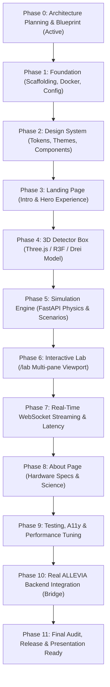

# DEVELOPMENT ROADMAP & PHASE SPECIFICATION
## ALLEVIA Environment Simulator: Phase 0 through Phase 11 Execution Blueprint

- **Document Version:** 1.0.0
- **Status:** Approved Roadmap
- **Phase:** Phase 0 — Technical Inspection & Architecture

---

## 1. Execution Philosophy & Quality Governance

The ALLEVIA Environment Simulator is built under strict phased delivery rules:
- **Phase-by-Phase Discipline:** No phase begins until the preceding phase has passed its quality gates and received explicit user approval.
- **Standalone-First Delivery:** Phases 0 through 9 construct a 100% complete, fully working, standalone simulator. Phase 10 introduces the real backend bridge. Phase 11 performs final production hardening.
- **Zero Inventions:** Hardware capabilities are strictly bound to confirmed physical components (Arduino Uno, BME280, MQ-2, MQ-7, MQ-135, IR Sensor).
- **Mandatory Quality Gates Before Every Git Commit:**
  1. Relevant tests executed and passing ($100\%$ green).
  2. TypeScript strict mode type checking executed (`tsc --noEmit` returns zero errors).
  3. Linter clean (`eslint` / `ruff` returns zero errors).
  4. Working tree inspected for unintended modifications or leaked secrets.
  5. Detailed completion report and exact proposed commit message submitted to user.
  6. Git commit and push executed ONLY upon explicit user approval.

---

## 2. Phase-by-Phase Breakdown

---

### Phase 0: Architecture Planning & Blueprint *(Current Phase)*
- **Objective:** Establish the comprehensive architectural foundation, physics models, hardware schemas, integration contracts, and development roadmap.
- **Key Deliverables:**
  - `docs/architecture/PROJECT-ARCHITECTURE.md`
  - `docs/architecture/SIMULATION-ENGINE.md`
  - `docs/architecture/REAL-BACKEND-INTEGRATION-PLAN.md`
  - `docs/architecture/DEVELOPMENT-ROADMAP.md`
- **Quality Gates:** Complete documentation coverage, zero application code, strict alignment with physical hardware constraints.

---

### Phase 1: Frontend & Backend Foundation
- **Objective:** Establish the development environment, project scaffolding, base configurations, and containerization.
- **Key Deliverables:**
  - `frontend/`: Vite + React 18 + TypeScript strict scaffolding, Tailwind CSS setup, Zustand store skeleton, directory structure.
  - `backend/`: FastAPI application factory, Uvicorn server, Pydantic settings, health check endpoint (`/api/health`), CORS setup.
  - `docker-compose.yml`: Multi-service orchestration for frontend and backend with hot-reload volumes.
  - Environment configurations (`.env.example` populated for local standalone development).
- **Quality Gates:**
  - `frontend`: `npm run build` succeeds, `tsc --noEmit` passes.
  - `backend`: `pytest` health check passes.
  - `docker compose up` starts both services without errors.

---

### Phase 2: Design System & Visual Primitives
- **Objective:** Construct the premium, futuristic industrial design system and reusable component primitives.
- **Key Deliverables:**
  - Theme tokens: Obsidian base (`#08090D`), surface levels, border strokes, and neon cyan-blue accents (`#00F0FF`).
  - Glassmorphic panels with backdrop filters, subtle noise grain texture overlay.
  - Typography system: Technical monospaced readouts (`JetBrains Mono`) and clean geometric sans headings (`Space Grotesk`).
  - Component library: Action buttons, sliders, segmented toggles, status pills, callout cards, telemetry readouts.
- **Quality Gates:** Storybook or component showcase tests pass; strict contrast ratios verified.

---

### Phase 3: Landing Page (`/`)
- **Objective:** Build the public-facing entry point for judges, showcasing the ALLEVIA Detector Box with immediate visual impact.
- **Key Deliverables:**
  - Full-screen hero section with interactive 3D preview teaser.
  - Value proposition breakdown: Early warning capabilities, workforce health protection.
  - Interactive "Enter Interactive Lab" CTA button with hover animations.
  - Responsive layout (desktop, tablet, mobile).
- **Quality Gates:** Responsive across mobile/desktop, Lighthouse performance score $>90$, smooth 60fps animations.

---

### Phase 4: 3D Detector Box Model & Viewport
- **Objective:** Implement the high-fidelity 3D digital twin of the physical Detector Box using Three.js, React Three Fiber, and Drei.
- **Key Deliverables:**
  - CAD-accurate procedural/GLTF models:
    - Matte black rounded-square enclosure with airflow grilles.
    - Arduino Uno Rev3 board with ATmega328P and headers.
    - BME280 breakout board.
    - MQ-2, MQ-7, and MQ-135 metal oxide gas sensors.
    - Optical IR sensor module.
    - Colored jumper wire harnesses.
    - Neon cyan-blue addressable LED perimeter ring.
  - OrbitControls with damped rotation and pan limits.
  - Exploded-view animation slider (smoothly displaces components outward along local axes).
  - Floating 3D annotation callout pins anchored to physical components.
- **Quality Gates:** 60 FPS rendering under standard WebGL 2.0; seamless exploded view transitions without clipping.

---

### Phase 5: Simulation Engine & Scenarios
- **Objective:** Implement the FastAPI physics and scenario engine generating authentic sensor dynamics.
- **Key Deliverables:**
  - Asynchronous simulation clock loop ($2\text{ Hz}$ tick rate).
  - 6 Data-driven scenario JSON configurations:
    1. Normal Day
    2. Midday Heatwave
    3. Humid Heat
    4. Smoke or Dust Episode
    5. Gas Leak (Simulated Demo Only)
    6. Sensor Fault
  - 10-bit ADC quantization model ($0\dots 1023$).
  - Gaussian noise generator and thermal drift models.
  - Fault injection engine (Sensor disconnect, stuck high/low, noise burst, packet drop).
  - Local simulated risk evaluator (`[SIMULATED]` tier transitions).
- **Quality Gates:** Unit tests for all mathematical models, ADC clamp checks, scenario keyframe interpolation tests.

---

### Phase 6: Interactive Lab (`/lab`)
- **Objective:** Deliver the primary evaluation cockpit combining 3D visualization, scenario controls, and real-time telemetry.
- **Key Deliverables:**
  - Multi-pane ergonomic layout:
    - Center: 3D interactive viewport with camera presets.
    - Left drawer: Scenario selector, environmental intensity slider ($0.5\times \dots 2.0\times$), simulation clock controls (play, pause, reset), fault injection panel.
    - Right panel: Real-time telemetry charts (last 60s), live ADC registers, converted engineering units, packet inspector.
    - Bottom bar: Status monitor, simulated risk-tier indicator, data packet counters.
- **Quality Gates:** Zero layout shifts, seamless interaction between scenario controls and 3D viewport, responsive design.

---

### Phase 7: Real-Time WebSocket Telemetry
- **Objective:** Implement bi-directional WebSocket streaming between the FastAPI backend and React frontend.
- **Key Deliverables:**
  - WebSocket endpoint `/ws/simulation` with connection pooling and heartbeat ping/pong.
  - Client auto-reconnect manager with exponential backoff.
  - Low-overhead binary/JSON packet serialization.
  - Real-time latency tracking (round-trip time indicator in UI).
  - Packet transmission monitor displaying raw JSON frames as they fly across the wire.
- **Quality Gates:** Zero memory leaks over continuous 30-minute streaming test; reconnect succeeds upon server restart.

---

### Phase 8: About & Technology Page (`/about`)
- **Objective:** Build the educational and technical deep-dive page for judges.
- **Key Deliverables:**
  - Detailed hardware breakdown (Arduino Uno, BME280, MQ-2, MQ-7, MQ-135, IR).
  - Atmospheric chemistry & biosensing methodology explanation.
  - Workforce health early warning principles.
  - Project architecture and technology stack documentation.
  - Interactive component exploration.
- **Quality Gates:** Accessible typography, full cross-browser rendering, zero broken links.

---

### Phase 9: Testing, Accessibility & Optimization
- **Objective:** Conduct rigorous end-to-end verification, accessibility audits, and performance tuning.
- **Key Deliverables:**
  - Complete automated test suite: Vitest for frontend components/stores, Pytest for backend physics/endpoints.
  - WCAG 2.1 AA accessibility compliance (keyboard navigation, ARIA live regions for telemetry, high contrast).
  - 3D asset optimization (geometry decimation, texture compression, draw-call minimization).
  - Lighthouse performance audit score $\ge 95$.
- **Quality Gates:** 100% test pass rate, clean accessibility audit, 60 FPS maintained during telemetry streaming.

---

### Phase 10: Real ALLEVIA Backend Integration
- **Objective:** Connect the simulator to the authentic ALLEVIA platform using the pluggable adapter pattern.
- **Key Deliverables:**
  - `AlleviaBackendAdapter` implementation forwarding canonical packets to real ingestion endpoints.
  - Data quarantine enforcement (`source = "simulated"`, `zone_id = "ZONE-SANDBOX-DEMO"`).
  - Real backend alert feed listener streaming authentic risk-tier changes to the frontend.
  - Dual-mode toggle (switch seamlessly between Standalone and Live Bridge).
  - Graceful fallback mechanism if the real backend is unreachable.
- **Quality Gates:** End-to-end telemetry verified on real backend; zero contamination of real health data confirmed.

---

### Phase 11: Final Audit, Release & Presentation Ready
- **Objective:** Perform final repository cleanup, production container builds, and deployment verification.
- **Key Deliverables:**
  - Final security scan (zero exposed credentials, sanitized `.env.example`).
  - Production Docker builds optimized for minimal image footprint.
  - Comprehensive `README.md` with judge quick-start instructions.
  - Git release tag (`v1.0.0-release`).
- **Quality Gates:** Full clean install from scratch on clean machine in $<3$ minutes.
