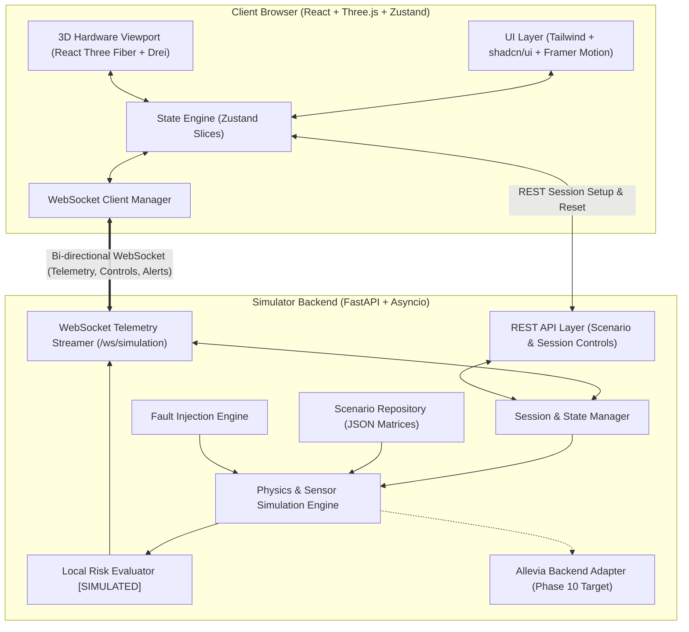

# PROJECT ARCHITECTURE & SYSTEM BLUEPRINT
## ALLEVIA Environment Simulator (Standalone Interactive 3D Platform)

- **Document Version:** 1.0.0
- **Status:** Approved Architecture Blueprint
- **Phase:** Phase 0 — Technical Inspection & Architecture
- **Target Audience:** Engineering Team, Hackathon Judges, Technical Evaluators

---

## 1. Executive Summary & Project Purpose

The **ALLEVIA Environment Simulator** is a standalone, web-based, high-fidelity interactive 3D hardware simulator for the physical **ALLEVIA Detector Box**. 

The ALLEVIA platform is an early warning system designed for workforce and population environmental health monitoring. Physical Detector Boxes deployed in industrial and urban zones continuously sample ambient atmospheric metrics, assess hazardous conditions, and stream telemetry into a centralized risk engine.

To enable hackathon judges, stakeholders, and technical evaluators to experience the hardware virtually without needing physical deployment:
1. The simulator provides a photorealistic 3D digital twin of the Detector Box, complete with exploded-view component inspection, internal component callouts, and real-time perimeter illumination.
2. An integrated standalone simulation engine generates authentic 10-bit ADC sensor dynamics across six rigorous environmental scenarios.
3. The platform operates completely autonomously (independent of the live ALLEVIA backend in Phases 0–9), while maintaining a strict adapter boundary for drop-in live backend integration in Phase 10.
4. All simulated telemetry and local risk tiers are explicitly watermarked (`source = "simulated"`), preserving strict data integrity.

---

## 2. High-Level Architecture

The simulator utilizes a decoupled, modern client-server architecture:
- **Frontend Client:** Single Page Application (SPA) powered by React 18, TypeScript (Strict Mode), Vite, Tailwind CSS, shadcn/ui, Framer Motion, Zustand, and Three.js / React Three Fiber / Drei.
- **Backend Service:** Asynchronous Python service powered by FastAPI, WebSockets, Asyncio, and Pydantic v2.
- **Data & Configuration Layer:** Version-controlled JSON scenario matrices, sensor calibration specifications, and deterministic mathematical models.
- **Containerization & Deployment:** Multi-stage Docker Compose orchestration supporting local development and cloud deployment.



---

## 3. Physical Hardware Specification & Constraints

The virtual 3D Detector Box is modeled with 1:1 fidelity based on the physical assembly:

| Hardware Component | Role & Interface | Real Physics & Output Range | Ingestion / Simulation Rules |
| :--- | :--- | :--- | :--- |
| **Arduino Uno (Rev3)** | Microcontroller & Processing Unit | ATmega328P, 16 MHz, 10-bit Successive Approximation ADC (0–1023). 5.0V reference ($4.887 \text{ mV/step}$). | No native network interface. Emulates serial packet assembly. Strictly quantizes analog sensors to integer ADC [0–1023]. |
| **BME280** | Digital Environmental Sensor | Temperature: $-40\text{ to }+85^\circ\text{C}$ ($\pm 1.0^\circ\text{C}$). Relative Humidity: $0\text{ to }100\%$ ($\pm 3\%$). Atmospheric Pressure: $300\text{ to }1100\text{ hPa}$ ($\pm 1.0\text{ hPa}$). Digital I2C interface. | Delivered as pre-calibrated floating-point metrics with realistic quantization and barometric thermal noise. |
| **MQ-2** | Combustible Gas & Smoke Sensor | Metal Oxide Semiconductor (MOS) sensor. Sensitive to LPG, Propane, Hydrogen, Smoke, Methane. Analog output. | Quantized to 10-bit ADC (0–1023). Implements resistance ratio $R_s/R_0$ logarithmic curve and thermal preheat phase. |
| **MQ-7** | Carbon Monoxide (CO) Sensor | High/Low heating cycle (5V high heat cleaning, 1.4V low heat detection). Analog output. | Quantized to 10-bit ADC (0–1023). Realistic ppm curves for CO accumulation and dispersion. |
| **MQ-135** | Air Quality & Noxious Gas Sensor | Sensitive to Ammonia ($NH_3$), Nitrogen Oxides ($NO_x$), Alcohol, Benzene, Carbon Dioxide ($CO_2$). Analog output. | Quantized to 10-bit ADC (0–1023). Elevated readings represent poor ventilation or volatile pollutants. |
| **IR Sensor** | Optical Obstacle / Beam Interrupter | Infrared emitter/phototransistor pair. Digital active-low or active-high output. | Binary state flag ($0 = \text{Clear}$, $1 = \text{Obstructed/Triggered}$). Used for dust occlusion or physical tamper detection. |
| **Jumper Wires & Harness** | Internal Connections | Multi-color ribbon harnesses connecting sensors to breadboard / Arduino headers. | Rendered in 3D exploded view with accurate color coding (Power, Ground, Signal). |
| **Chassis Enclosure** | Industrial Housing | Matte-black rounded-square chassis with perforated sensor airflow grilles. | Rendered in 3D with realistic PBR materials, micro-bevels, and internal mounting standoffs. |
| **Perimeter Illumination** | Status Ring | Cyan-blue addressable LED perimeter ring around the enclosure edge. | Emits ambient glow reflecting device status, telemetry pulsing, and simulated tier alerts. |

### Negative Scope Constraints (Strict Enforcement)
- **NO PM2.5 / Optical Particle Counters:** The physical hardware does NOT possess a PMS5003 or similar laser dust sensor. PM2.5 must never be manufactured or added to the telemetry packet.
- **NO Globe-Temperature Sensor:** The physical box does not have a black-globe thermometer probe. WBGT calculations requiring globe temperature must not be simulated as hardware outputs.
- **NO Direct Hardware Networking:** The physical Arduino Uno communicates via serial. The simulator models this packet boundary accurately.

---

## 4. Frontend Architecture

### 4.1 Route Hierarchy
- **`/` (Intro / Hero):** High-impact introductory landing page featuring the hero 3D Detector Box preview, value proposition, early warning highlights, and entry point to the interactive lab.
- **`/lab` (Interactive Simulation Lab):** Primary evaluation cockpit:
  - Central 3D viewport (Orbit controls, exploded view toggle, component callouts, LED status ring).
  - Left control drawer (Scenario selector, environmental intensity slider, simulation clock controls, fault injection triggers).
  - Right telemetry panel (Real-time charts, ADC raw feeds, converted physical units, packet transmission monitor).
  - Bottom status bar (Simulated risk tier indicator, latency meter, WebSocket connection health).
- **`/about` (Hardware & Technology):** Technical documentation page detailing physical hardware components, calibration curves, biosensing principles, and the development roadmap.

### 4.2 State Management Architecture (Zustand)
Global state is segmented into domain slices to ensure atomic re-renders:
- `useSimulationStore`: Controls simulation playback (idle, running, paused), elapsed time, active scenario ID, intensity multiplier, and random seed.
- `useTelemetryStore`: Holds rolling telemetry buffers (last 120 points for charts), raw ADC registers, converted metrics, and packet transmission history.
- `useViewportStore`: Controls 3D camera viewpoints (Default, Perspective, Top, Exploded Assembly, Sensor Focus), exploded displacement factor, and callout visibility.
- `useFaultStore`: Manages active fault injections (Sensor disconnect, stuck-high, stuck-low, thermal drift, noise boost).
- `useAlertStore`: Manages simulated risk-tier status, hazard alerts, and event notification toasts.

### 4.3 3D Visualization Pipeline (Three.js / React Three Fiber / Drei)
- **Scene Composition:** Procedural and GLTF-assisted assemblies of the Detector Box.
- **Exploded View Animation:** Smooth vector translation along local normal axes using Framer Motion 3D / spring lerp functions.
- **Lighting & Materials:** Studio HDR environment with metallic-roughness PBR materials, rim lights, and custom emissive cyan-blue shaders.
- **Annotation Callouts:** HTML/SVG overlay pins pinned to 3D matrix transforms using Drei's `<Html />` component with depth culling and dashed line anchors.

---

## 5. Backend Architecture (FastAPI & Asyncio)

### 5.1 Service Directory Layout
```text
backend/
├── app/
│   ├── api/
│   │   ├── endpoints/
│   │   │   ├── session.py      # Session init, reset, status
│   │   │   ├── scenarios.py    # Scenario metadata & matrix loader
│   │   │   ├── fault.py        # Fault injection endpoints
│   │   │   └── telemetry.py    # Snapshot & history retrieval
│   │   └── router.py
│   ├── core/
│   │   ├── config.py           # Pydantic Settings & environment variables
│   │   └── security.py         # Origin checks, rate limiters, session tokens
│   ├── engine/
│   │   ├── physics/            # Sensor physics, drift models, noise functions
│   │   ├── scenarios/          # JSON scenario definitions & interpolation
│   │   ├── fault_injector.py   # Fault disruption engine
│   │   ├── packet_builder.py   # Canonical hardware packet assembler
│   │   ├── local_evaluator.py  # Standalone simulated risk-tier processor
│   │   └── simulator.py        # Central asyncio loop & clock manager
│   ├── schemas/
│   │   ├── packet.py           # Hardware packet Pydantic schemas
│   │   ├── scenario.py         # Scenario definition schemas
│   │   └── telemetry.py        # WebSocket message schemas
│   ├── websockets/
│   │   ├── connection.py       # Client connection pool & heartbeat
│   │   └── stream.py           # Telemetry broadcaster
│   └── main.py                 # FastAPI application factory
├── tests/
│   ├── test_engine.py
│   ├── test_packets.py
│   └── test_scenarios.py
├── Dockerfile
└── requirements.txt
```

### 5.2 Asyncio Simulation Engine Loop
The simulation engine runs a deterministic timer loop at a default frequency of **2 Hz** (500ms intervals, matching typical embedded sensor polling rates):
1. **Clock Advance:** Increments simulation delta time ($dt$).
2. **Scenario Interpolation:** Evaluates active scenario curve values at time $t$ for all channels.
3. **Environmental Intensity Scaling:** Applies user-selected intensity coefficient ($\alpha \in [0.5, 2.0]$).
4. **Physical Noise & Drift Injection:** Computes Gaussian white noise ($\mathcal{N}(0, \sigma^2)$) and thermal drift.
5. **ADC Quantization:** Maps continuous physical voltages to 10-bit integer ADC registers ($0\dots 1023$).
6. **Fault Injection Matrix:** Applies active faults (e.g., pinning MQ-7 to 1023 or dropping BME280 to `null`).
7. **Packet Assembly:** Wraps registers into the canonical hardware packet.
8. **Local Risk Evaluation:** Passes packet through `LocalRiskEvaluator` to compute simulated tier transitions.
9. **WebSocket Broadcast:** Dispatches JSON payload to connected frontend clients.

---

## 6. Design System & Aesthetics

The UI adheres strictly to a **premium, minimal, futuristic industrial design**:
- **Backgrounds:** Deep layered obsidian and charcoal:
  - Base: `#08090D`
  - Surface Level 1 (Panels): `#0F1118` (80% opacity with `backdrop-blur-md`)
  - Surface Level 2 (Cards): `#161922`
  - Border Lines: `#232736` (1px subtle strokes)
- **Accents:** High-energy neon cyan-blue:
  - Primary Accent: `#00F0FF`
  - Subtle Accent: `#00A3B5`
  - Glow Hue: `rgba(0, 240, 255, 0.15)`
  - Warning Accent: `#FFB800` (Amber)
  - Critical Accent: `#FF3366` (Crimson Neon)
- **Typography:** Technical monospaced and clean geometric sans-serif:
  - Headings: `Space Grotesk` or `Inter Display`
  - Data Feeds / ADC / Telemetry: `JetBrains Mono` or `Fira Code`
- **Visual Styling:**
  - Fine dashed sensor callout lines ($0.75\text{px}$, `#00F0FF` at 40% opacity).
  - Subtle noise grain overlay to eliminate digital flatness.
  - Zero generic purple/pink gradients, zero bloated cards, zero decorative illustrations.

---

## 7. Technology Stack Summary

```text
Frontend:
├── Framework: React 18
├── Language: TypeScript (Strict Mode)
├── Build Tool: Vite
├── Styling: Tailwind CSS
├── Primitives: Radix UI / shadcn/ui
├── Animation: Framer Motion
├── State Management: Zustand
├── 3D Rendering: Three.js
├── Declarative 3D: React Three Fiber (R3F)
├── 3D Helpers: @react-three/drei
└── Testing: Vitest + React Testing Library

Backend:
├── Framework: FastAPI
├── Language: Python 3.11+
├── Asynchronous Runtime: Asyncio + Uvicorn
├── WebSocket Engine: Native FastAPI WebSockets
├── Validation: Pydantic v2
└── Testing: Pytest + Pytest-Asyncio

Containerization & Deployment:
├── Docker & Docker Compose
└── Multi-stage lightweight builds (Alpine / Slim)
```

---

## 8. Verification & Governance Rules

1. **Independent Verification:** The simulator must achieve 100% feature completeness in standalone mode before Phase 10 begins.
2. **Explicit Watermarking:** Every simulated frame, packet, and UI alert must indicate its simulated provenance.
3. **No Phantom Hardware:** Only verified physical sensors (Arduino Uno, BME280, MQ-2, MQ-7, MQ-135, IR Sensor) are present in the simulator.
