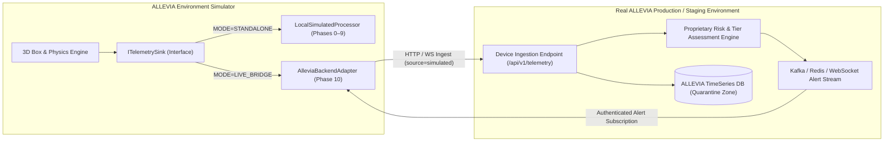

# REAL ALLEVIA BACKEND INTEGRATION PLAN
## Phase 10 Adapter Architecture, Data Quarantine, and Telemetry Bridge

- **Document Version:** 1.0.0
- **Status:** Approved Integration Specification
- **Phase:** Phase 0 Blueprint for Phase 10 Implementation

---

## 1. Integration Strategy & Dual-Mode Architecture

The ALLEVIA Environment Simulator is designed to operate in two distinct modes without altering its core UI or 3D visualization layers:

1. **Standalone Simulation Mode (Phases 0–9):**
   - Operates completely locally using the built-in FastAPI simulation engine and `LocalRiskEvaluator`.
   - Requires zero external dependencies, credentials, or network connections.
   - Ideal for local hackathon evaluation, development, and offline demonstrations.
2. **Live Backend Bridge Mode (Phase 10 Target):**
   - Telemetry generated by the 3D simulator is encapsulated into canonical hardware packets and transmitted directly into the real ALLEVIA backend ingestion endpoint.
   - Real-time risk assessments, population alerts, and zone tier transitions calculated by the authentic ALLEVIA risk engine are streamed back to the simulator frontend.
   - Zero faked alerts or simulated transitions when operating in this mode.



---

## 2. Canonical Hardware Telemetry Packet Schema

The packet structure strictly mirrors the data channels delivered by the physical Arduino Uno and sensor breakout boards.

### 2.1 Packet Specification (JSON Representation)
```json
{
  "$schema": "http://json-schema.org/draft-07/schema#",
  "title": "AlleviaHardwareTelemetryPacket",
  "type": "object",
  "required": [
    "device_id",
    "timestamp",
    "seq_num",
    "source",
    "hardware",
    "sensors"
  ],
  "properties": {
    "device_id": {
      "type": "string",
      "pattern": "^ALLEVIA-[A-Z0-9]{3}-[0-9]{3}$",
      "example": "ALLEVIA-SIM-001"
    },
    "zone_id": {
      "type": "string",
      "example": "zone-sandbox-virtual-lab"
    },
    "timestamp": {
      "type": "string",
      "format": "date-time",
      "example": "2026-11-16T14:45:00.000Z"
    },
    "seq_num": {
      "type": "integer",
      "minimum": 0,
      "example": 1042
    },
    "source": {
      "type": "string",
      "enum": ["simulated"],
      "description": "Strict isolation tag; must never be 'hardware' in simulator."
    },
    "hardware": {
      "type": "object",
      "required": ["board", "adc_bits", "v_ref"],
      "properties": {
        "board": { "type": "string", "example": "Arduino_Uno_Rev3" },
        "adc_bits": { "type": "integer", "enum": [10] },
        "v_ref": { "type": "number", "example": 5.0 }
      }
    },
    "sensors": {
      "type": "object",
      "required": ["bme280", "mq2", "mq7", "mq135", "ir"],
      "properties": {
        "bme280": {
          "type": "object",
          "required": ["temperature_c", "humidity_pct", "pressure_hpa"],
          "properties": {
            "temperature_c": { "type": "number", "minimum": -40.0, "maximum": 85.0 },
            "humidity_pct": { "type": "number", "minimum": 0.0, "maximum": 100.0 },
            "pressure_hpa": { "type": "number", "minimum": 300.0, "maximum": 1100.0 }
          }
        },
        "mq2": {
          "type": "object",
          "required": ["raw_adc", "voltage_v"],
          "properties": {
            "raw_adc": { "type": "integer", "minimum": 0, "maximum": 1023 },
            "voltage_v": { "type": "number", "minimum": 0.0, "maximum": 5.0 }
          }
        },
        "mq7": {
          "type": "object",
          "required": ["raw_adc", "voltage_v"],
          "properties": {
            "raw_adc": { "type": "integer", "minimum": 0, "maximum": 1023 },
            "voltage_v": { "type": "number", "minimum": 0.0, "maximum": 5.0 }
          }
        },
        "mq135": {
          "type": "object",
          "required": ["raw_adc", "voltage_v"],
          "properties": {
            "raw_adc": { "type": "integer", "minimum": 0, "maximum": 1023 },
            "voltage_v": { "type": "number", "minimum": 0.0, "maximum": 5.0 }
          }
        },
        "ir": {
          "type": "object",
          "required": ["state"],
          "properties": {
            "state": { "type": "integer", "enum": [0, 1] }
          }
        }
      }
    },
    "checksum": {
      "type": "string",
      "description": "CRC32 or HMAC-SHA256 of the payload fields."
    }
  }
}
```

---

## 3. Strict Data Quarantine & Operational Isolation

To ensure that the simulator never contaminates real-world health surveillance records, the integration architecture enforces four mandatory isolation barriers:

### Barrier 1: Mandatory Source Watermarking
Every JSON payload transmitted over HTTP or WebSockets must include:
```json
"source": "simulated"
```
The real backend ingestion pipeline must reject or quarantine any simulated packet attempting to pass as `source: "hardware"`.

### Barrier 2: Dedicated Virtual Sandbox Zone
- All simulated runs are assigned to a reserved virtual zone identifier:
  `zone_id = "ZONE-SANDBOX-DEMO"`
- Real dashboard aggregates, historical population epidemiological statistics, and public warning siren systems must exclude `ZONE-SANDBOX-DEMO`.

### Barrier 3: Ephemeral Virtual Device Registration
- Virtual devices are registered with a reserved MAC / Device ID prefix:
  `device_id = "ALLEVIA-SIM-XXX"`
- Virtual devices carry an expiration TTL (Time-To-Live). Once the simulation session ends, the device is deactivated.

### Barrier 4: Ephemeral Session Cleanup
The simulator backend exposes a `/session/teardown` lifecycle hook that purges session-scoped telemetry from the quarantine buffer upon user disconnect or scenario reset.

---

## 4. Phase 10 Integration Implementation Checklist

When connecting the real ALLEVIA backend in Phase 10:

1. **Backend Discovery & Handshake:**
   - Configure `ALLEVIA_API_BASE_URL` and `ALLEVIA_DEVICE_KEY` in `backend/.env`.
   - Issue health check handshake to verify real backend availability:
     `GET ${ALLEVIA_API_BASE_URL}/health`
2. **Sandbox Device Provisioning:**
   - Call real backend provisioning endpoint (or obtain pre-authorized test key) for `ALLEVIA-SIM-001`.
   - Ensure the provisioned device is mapped to the sandbox zone.
3. **Adapter Activation:**
   - Switch `SIMULATOR_MODE` environment variable from `STANDALONE` to `LIVE_BRIDGE`.
   - The backend `TelemetrySink` switches active implementation to `AlleviaBackendAdapter`.
4. **Real Alert Forwarding:**
   - Establish an authenticated WebSocket listener to the real ALLEVIA risk feed:
     `WSS ${ALLEVIA_WS_BASE_URL}/ws/zones/ZONE-SANDBOX-DEMO/alerts`
   - Forward real alert events to the simulator frontend, displaying authentic tier transitions.
5. **Rollback Plan:**
   - If the external backend becomes unreachable, network latency exceeds $1500\text{ ms}$, or authentication fails, the simulator backend gracefully falls back to `STANDALONE` mode with a visual UI indicator informing the user: `"Real backend unreachable — running on local simulation engine"`.
